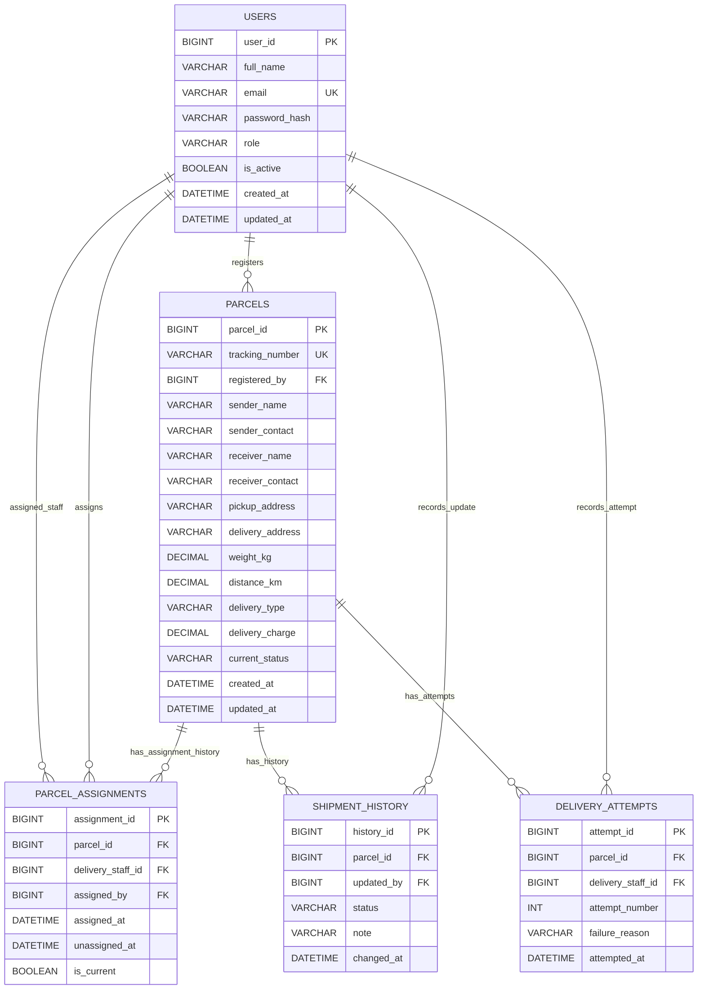

# Logical Database Design — Parcel Dispatch and Tracking System

## 1. Design basis and scope

SRS section 7.3 explicitly requires storage for:
- User accounts and roles.
- Parcel details.
- Delivery staff assignments.
- Shipment status history.
- Delivery attempts.

This document defines a **logical data model** for those items. It is not a claim that the physical MySQL schema has already been implemented. Exact column sizes, enum implementation, address details, pricing policy, and retry policy should be agreed before finalizing the schema.

Customers are public tracking users in the SRS; customer account registration is listed as a future enhancement. Therefore, the proposed `users` table represents staff accounts, not mandatory customer accounts.

## 2. Entity relationship diagram

## 3. Entity descriptions

| Entity | Purpose | Important fields / integrity |
|---|---|---|
| users | Administrator/Courier Clerk and Delivery Staff accounts | Unique email; password hash only; role; active flag |
| parcels | Sender/receiver, shipment details, price, tracking number, current status | Unique tracking number; required details; weight greater than zero |
| parcel_assignments | Current and historical delivery staff assignments | Foreign keys to parcel and delivery staff; records assigning staff and assignment time |
| shipment_history | Append-only status-change timeline | Parcel, status, timestamp, and actor; one parcel has many history rows |
| delivery_attempts | Records delivery attempts, especially failed attempts | Parcel, staff member, attempt number, reason, timestamp |

## 4. Relationships and cardinalities

- One staff account can register many parcels.
- One parcel can have multiple assignment records over time.
- One delivery staff member can be assigned multiple parcels.
- One parcel has many shipment-history rows.
- One parcel can have zero or more delivery-attempt rows.
- A staff account can be responsible for many shipment-history updates and delivery attempts.

## 5. Candidate database constraints and indexes

These are implementation recommendations derived from the SRS integrity requirements:

- Primary key for each entity.
- Unique constraint on `users.email`.
- Unique constraint on `parcels.tracking_number` (BR-01, NFR-11 and NFR-22).
- Foreign keys for every relationship.
- Enforce `weight_kg > 0` (FR-14 / BR-03) both in application validation and, where supported, a database check.
- Index `parcels.current_status` for operational work queues.
- Index `shipment_history(parcel_id, changed_at)` for chronological tracking.
- Index `delivery_attempts(parcel_id, attempt_number)`.
- Index `parcel_assignments(delivery_staff_id, is_current)` for a staff member's assigned parcels.

The SRS does not dictate the exact technique for enforcing at most one active assignment. Select a transaction-safe approach compatible with the deployed MySQL version.

## 6. Transaction boundaries

The following operations should be atomic:

1. **Register parcel:** insert the parcel and its initial Booked shipment-history row in one transaction.
2. **Assign staff:** create/update the assignment record and set the parcel status to Assigned, with a corresponding history row in one transaction.
3. **Update status:** verify the current state, update the parcel, and append shipment history in one transaction.
4. **Record failed delivery:** save the attempt and relevant status/history update consistently in one transaction.

This prevents the parcel's current status from becoming inconsistent with its shipment history.

## 7. Privacy

The public tracking operation should return only the fields needed to communicate parcel progress. It must not return password hashes, staff account details, or unnecessary sender/receiver contact data. This supports FR-34, FR-35, and BR-10.

## 8. Decisions not specified by the SRS

The submitted SRS does not define:
- The full physical schema or exact field lengths.
- A final delivery charge formula or numerical rate values.
- A numeric failed-delivery retry limit.
- A detailed address structure.
- Data-retention and archival rules.

These values must not be invented in the database schema. Agree them with the team/business assumptions and record them in a revised or supplementary requirements note before implementation and test-case finalization.
