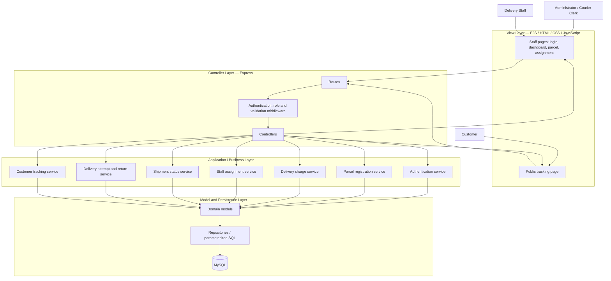

# System Architecture — Parcel Dispatch and Tracking System

## 1. Architectural approach

The application uses **Model–View–Controller (MVC)** as its primary architecture, with service and repository modules to keep business rules and database access separate. This is still an MVC design: routes dispatch requests, controllers coordinate the request/response, models represent domain data, and EJS views render the interface.

- **Model:** domain entities and persistence-facing data structures.
- **View:** EJS templates, layouts, and partials.
- **Controller:** handles HTTP requests and chooses the response.
- **Service layer:** applies use cases and business rules.
- **Repository layer:** performs SQL and database transactions.

Technology is based on the approved proposal and SRS: Node.js, Express.js, EJS, HTML/CSS/JavaScript, and MySQL.

## 2. High-level component diagram



The diagram shows logical responsibilities. The concrete source modules can be introduced incrementally without moving or replacing the frontend pages being developed by the UI team member.

## 3. Request processing sequence

1. A user opens an EJS page or submits an HTTP form.
2. An Express route maps the URL and method to the relevant controller.
3. Middleware checks staff authentication, role permissions, and request validation where required.
4. The controller extracts request data and calls a service.
5. The service enforces business rules and coordinates model/repository operations.
6. Repositories execute parameterized SQL against MySQL. Operations that update related records use a transaction.
7. The controller renders an EJS view, redirects, or sends a response.

Customer tracking is public and read-only; it must not require a customer account and must not expose private staff account information.

## 4. Main MVC components

| Component | Responsibility | Candidate modules |
|---|---|---|
| Routes | URL/method mapping and middleware attachment | auth, parcel, staff, tracking routes |
| Controllers | HTTP request/response orchestration | auth, parcel, staff, tracking controllers |
| Models | Domain records and relationships | User/Staff, Parcel, ParcelAssignment, ShipmentHistory, DeliveryAttempt |
| Views | User-facing EJS pages and partials | auth, admin, staff, tracking, shared partials |
| Services | Business rules and application workflows | authentication, pricing, parcel, assignment, status, attempts/returns, tracking |
| Repositories | SQL access and transactions | user, parcel, assignment, shipment history, attempt repositories |
| Middleware | Authentication, authorization, validation, error handling | auth, role, validation, error middleware |
| Configuration | Environment and database configuration | env, database pool, approved business settings |

## 5. Role boundaries

The project has three user groups in the proposal and SRS:

- **Administrator / Courier Clerk:** authenticated staff who register parcels, calculate charges, assign delivery staff, search records, and manage parcels/returns.
- **Delivery Staff:** authenticated staff who view assigned parcels and update permitted delivery information.
- **Customer:** no account required; enters a tracking number to view the current status and shipment history.

Do not add a separate Office Staff role unless the team formally changes the SRS.

## 6. SRS status lifecycle

SRS FR-20 lists the following statuses:

1. Booked
2. Assigned
3. Dispatched
4. Out for Delivery
5. Delivered
6. Delivery Failed
7. Return Initiated
8. Return in Transit
9. Returned to Sender

Conceptual flow:

```text
Booked -> Assigned -> Dispatched -> Out for Delivery
                                      |             |
                                      |             +-> Delivered
                                      |
                                      +-> Delivery Failed
                                               |
                                               +-> retry, if allowed by approved policy
                                               |
                                               +-> Return Initiated
                                                        -> Return in Transit
                                                        -> Returned to Sender
```

The SRS does not define a complete transition matrix or a numeric retry limit. Those rules must be agreed with the courier/business assumptions and documented before being encoded in the status service.

Important SRS constraints:
- A parcel cannot be dispatched before it has been assigned (FR-18 / BR-05).
- Invalid status transitions must be rejected (FR-23).
- A failed delivery attempt must include a reason and the number of attempts must be recorded (FR-25 / FR-26).
- Each status update must have date/time and be preserved in shipment history (FR-21 / FR-22 / BR-08).
- A Delivered parcel cannot be moved to an earlier delivery status by an ordinary update (BR-06).
- Each parcel must have a unique tracking number (FR-08 / BR-01 / NFR-11 / NFR-22).

## 7. Security and quality responsibilities

- Enforce permissions on the server, not only by hiding UI links.
- Delivery staff should only operate on parcels permitted by their assignments and role.
- Customer tracking is read-only and returns only information needed to communicate shipment progress (FR-34 / FR-35 / BR-10).
- Store password hashes, never plaintext passwords (NFR-14).
- Validate input on the server and use parameterized SQL (NFR-15).
- Make service modules independently testable with Jest; verify HTTP behaviour with Supertest.
- Use database transactions for multi-record changes such as parcel creation plus initial history, and status changes plus history.

## 8. Requirement mapping

| SRS requirements | Main components |
|---|---|
| FR-01 to FR-04 — authentication | auth routes/controller/service, auth middleware, user repository |
| FR-05 to FR-10 — parcel registration and search | parcel routes/controller/service, validators, parcel repository, tracking-number generation |
| FR-11 to FR-14 — charge calculation | pricing service and approved pricing configuration |
| FR-15 to FR-18 — staff assignment | parcel/staff routes, assignment service, role middleware, repositories |
| FR-19 to FR-23 — status and history | status service, parcel repository, shipment-history repository |
| FR-24 to FR-28 — failed deliveries and returns | delivery-attempt/return service and repository |
| FR-29 to FR-35 — customer tracking | public tracking route/controller/service and a restricted read query |
| NFR-12 to NFR-16 — security | auth, role middleware, validation, password hashing, public-data minimization |
| NFR-17 to NFR-19 — maintainability | MVC separation, services, repositories, configurable rules |

## 9. Known inconsistency to resolve

The existing `docs/BACKEND.md` draft currently describes a shortened status flow and includes `CANCELLED`, which is not one of the nine statuses in SRS FR-20. This architecture document follows the submitted SRS. Reconcile the backend note and any existing tests with the SRS, or formally revise/version the SRS before adding or changing statuses.
